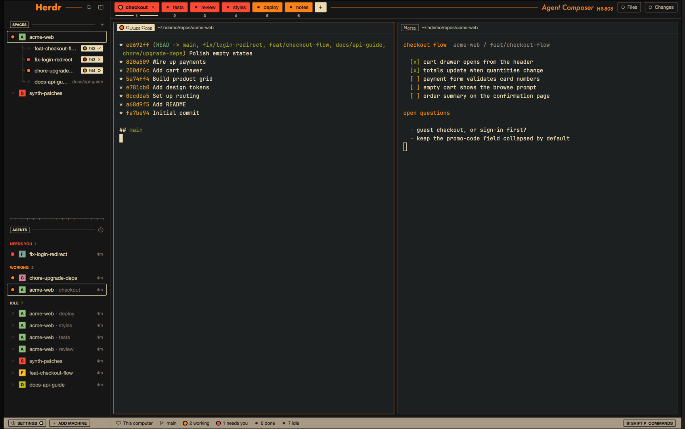

# HR-808

Herdr dressed as a Roland TR-808 drum machine, on the gruvbox palette. Tabs are the 808's colored step keys with step numbers printed under them. Agent status shows on dark-glass LEDs throughout. Spaces and agents read like the panel's printed labels, and a gray strip runs along the bottom like the 808's step panel. Underneath it's Herdr's own layout, so nothing in the usual workflow moves. It's a fan homage to the TR-808 and isn't affiliated with Roland.



## What you see

The window is a row. Black chassis edges (8px, a `#0a0a0a`→`#202020` gradient at 90°) frame a near-black chassis (`canvas`, 1px `#000000` border). The chassis splits into a sidebar on the left and the work area on the right, divided by a 1px `dim` rule. The system title bar is hidden, and the macOS window buttons sit at `[20, 10]`.

**Theme** (`themes/tr808.json`): gruvbox dark hard (terminal background `#1d2021`, foreground `#ebdbb2`, gruvbox ANSI), with these overrides:
- canvas and chrome `#161616`, raised `#32302f`, hover `#3c3836`, selected `#504945`, border `#3c3836`, input `#665c54`
- muted `#bdae93`, dim `#7c6f64`
- accent `#fe8019` (the 808's orange print)
- working `#fe8019`, blocked `#fb4934`, done `#fabd2f`, idle `#665c54`

UI font Helvetica Neue; the print is Futura. Lettering on colored keys and the gray strip is ink `#111111`.

**Sidebar** (268px, collapses to 44px), top to bottom:
- **Brand row** (46px):
  - "Herdr" in Futura bold 21px orange, then a 1px orange rule out to the search and sidebar-toggle buttons (26px).
  - Everything sits 4px from the top on a 26px line, the same line as the tab keys, so this rule and the tab bar's rule read as one continuous printed line across the window.
- **Spaces:**
  - **Heading:** "SPACES" in a 16px box with a cream 1px outline (9px semibold, like the 808's INSTRUMENT-SELECT), a 1px `dim` rule, and a drawn + to make a space.
  - **Rows:** each row starts with an LED, then for top-level spaces an 18px step key in the space's color with its initial in ink, then the name in cream.
  - **Key colors:** the space's color at gruvbox's bright step: aqua, yellow, blue, pink, green or red.
  - **Worktrees:** indented 40px under their repo, joined to the repo's key by thin `dim` bracket lines (└ for the last one, ├ above it).
  - **PR labels** (right edge, 16px tall, radius 2):
    - Beige (`#ebdbb2`) while open; tan (`#bdae93`) once merged, closed, a draft, or unreadable.
    - Inside: a checks LED (red failing, yellow running, green passing), the PR number, then a 10px review mark: ✓ approved, ✗ changes requested, ○ review required, nothing when there's no review yet.
- **Divider:** a 1px `dim` rule with 17 tick marks, 4px tall, like the 808's channel dividers.
- **Agents:**
  - **Heading:** a boxed "AGENTS", a rule, and the sort button.
  - **Section headings** in 9.5px semibold capitals in their status color: NEEDS YOU, WORKING, DONE, IDLE (priority sort), or space names (grouped sort).
  - **Rows:** an LED, the agent's space key, the name (idle agents in `muted`), and the time since it changed.
  - **Sub-agents** hang off tree lines, with their program icon as a one-color `muted` glyph.
- **Footer** (28px): the left end of the gray strip, holding SETTINGS (a cream LED when an update waits) and ADD MACHINE as boxed 18px ink labels.

**Work area:**
- **Tab bar** (46px):
  - **Tab keys:** one per tab, 26px tall, 60–220px wide, radius 3, in fours by position: red `#fb4934`, orange `#fe8019`, yellow `#fabd2f`, cream `#ebdbb2`, then repeating.
  - **On each key:** an LED and the tab name in ink 12.5px. The shown tab is semibold with a × to close it.
  - **Under each key:** its step number (10px). The shown tab's number sits on a 2px cream bar.
  - **After the keys:** a cream + key (30×26), then a 1px orange rule that fills to "Agent Composer" (Futura italic 17px orange) and "HR-808" (Futura 12px).
  - **Right end:** Files and Changes switches (26px, outlined): a hollow ring when closed, a cream LED in a black socket when open.
- **Panes:** cards with radius 3, 8px gaps, a 1px `border` edge, and a 1px orange edge on the focused one.
  - **Header** (28px): a label (18px, radius 2) holding the status LED and the program name in 808 lettering. The lettering keeps capitals and each word's first letter full size and sets the rest as smaller capitals, as in "BassDrum".
  - **Label style:** solid cream while the pane is focused, outlined otherwise.
  - **After the label:** the folder in `muted`, and on hover the split right, split down, zoom and close buttons.
- **Files / Changes panel:** a 368px panel on the right, hidden until opened.
- **Status strip** (28px, gruvbox gray `#a89984`, ink 11.5px):
  - the machine and branch
  - LED meters: "N working", "N need you" ("1 needs you"), "N done", "N idle"
  - at the right, a boxed "⌘ SHIFT P COMMANDS"

**LEDs** are the same everywhere:
- **Lit:** a 12px black socket holding an 8px mark. Working is an orange dot, blocked a red square, done a yellow ring (1.5px).
- **Off:** a 6px dark-red glass dot (`#3a1611`) in the same 12px space.

## How it behaves

- **Agent status:**
  - **working:** an orange dot.
  - **blocked:** a red square, plus a red "Needs you" label on the agent's row (or a NEEDS YOU section when sorted by priority).
  - **done:** a yellow ring.
  - **idle:** dark glass, with the agent's name dimmed.
  - A space's LED shows its most urgent agent. Hovering it names the agent and state.
- **Nothing animates:** working and blocked can last for hours, so the LEDs hold steady instead of blinking or spinning.
- **Tab keys:**
  - Click selects the tab, drag reorders, double-click renames, and right-click opens the tab menu.
  - Scrolling over the bar steps through tabs.
  - The numbers are the `cmd-1`…`cmd-9` shortcuts. The keys scroll when there are more than fit.
- **+ key:** opens the new-tab menu (a terminal or any installed agent).
- **Files / Changes:** each switch toggles its panel. The open panel is remembered per space.
- **Spaces:**
  - Click selects, drag reorders (worktrees among their repo's), and right-click opens the space menu.
  - Clicking a PR label opens the PR.
  - Rows have a faint cream outline on hover and a solid cream outline when selected, with a pointer cursor.
- **Agents:**
  - Click focuses the agent's pane. Hover shows a pin button, and pinned agents stay at the top.
  - Sub-agents fold under their parent; clicking one peeks at it.
  - The sort button switches between priority and grouped by space.
- **Collapsed sidebar** (the toggle in the brand row, or `cmd-b`):
  - Spaces and agents become 20px step keys printed with their position number (the space number matches `ctrl-1`…`ctrl-9`).
  - The LED sits on the key's corner while something is going on, and hovering shows the name.
- **Status strip:** the COMMANDS label opens the palette.
- **Footer:** SETTINGS opens settings and ADD MACHINE opens the machine dialog.
- **Brand row:** search opens the space picker. The brand row and tab bar drag the window.

## Built from

**Node tree** (`layouts/tr808.json`):

```
root row (theme tr808, ui_font Helvetica Neue, padding [0,8], gradient, titlebar none, traffic_lights [20,10], terminal_padding [14,12])
└ chassis row (canvas, border 1 #000000, divider 1 dim)
  ├ sidebar column 268px (min 44, max 480, chrome, resizable false)
  │ ├ brand block 46px, window_drag    { mod: tr808, props: { part: "brand" } }
  │ ├ sidebar-lists column
  │ │ ├ spaces block weight 1, min 90  { mod: tr808-spaces, props: { look: "808" } }
  │ │ └ agents block weight 1, min 90  { mod: tr808-agents }
  │ └ sidebar-footer block 28px        { mod: tr808, props: { part: "footer" } }
  └ work column (resizable false)
    ├ tabs block 46px, window_drag     { mod: tr808, props: { part: "tabs" } }
    ├ work-body row (padding 8, gap 8)
    │ ├ main block { tab: "active", pane: { header: { content: { mod: tr808 }, height 28, top, always },
    │ │              background "background", border 1 border, focus 1 accent, radius 3, gap 8, lone true } }
    │ └ panel column 368px (min 280, max 900, hidden) → panel-body stack: files, changes (shipped mods)
    └ status block 28px                { mod: tr808, props: { part: "status" } }
```

The ids `sidebar`, `panel`, `panel-body`, `files` and `changes` match the shipped `main` layout, so `cmd-b` and the shipped panel commands still work.

**Mods:**
- **`tr808`:** one mod drawing five parts.
  - **How parts are picked:** a layout block names its part in `props.part`. A pane header is recognized by `props().pane`, which Herdr gives it.
  - **The parts:** `tabs.js` (tab keys, + key, rule, print, switches), `brand.js`, `footer.js`, `status.js` and `pane.js` (the pane header).
  - **Shared helpers:** `panel.js` holds `caps()` (the 808 lettering), `led()`/`mark()` and `INK`.
  - **Art:** `plus.svg`.
  - **Shipped icons it borrows:** `mods/workspace-chrome/*.svg` and `mods/pane/*.svg`.
- **`tr808-spaces`:** a clone of the shipped `spaces` mod (0.1.7). The whole 808 look sits behind `props().look === "808"`; without the prop it draws the stock list.
  - **Added on top of the stock list:**
    - `statusLed`, `stepKey` and `compactKey`
    - the bracket lines (a `parent` flag set in `ordered()`)
    - the boxed heading
    - `trackLabel` (the PR labels) and the review marks (`circle.svg`, plus the shipped `check.svg` and `x.svg`)
  - **Space colors:** come from shared `space.colors`, the same names the stock list stores, mapped to the theme's bright ANSI step.
- **`tr808-agents`:** a clone of the shipped `agents` mod (0.1.7) with `led()`, `spaceKey()`, the boxed heading, the tick rule, the section headings, cream row edges, numbered collapsed keys and one-color sub-agent glyphs.
- **Shipped mods it uses as they are:** `files`, `changes`, `new-menu`, `menu`, `picker`, `machine-add`.

**`herdr` functions and commands:**
- **Data:** `spaces()`, `agents()`, `panes()`, `terminals()`, `focused()`, `layout()`, `theme()`, `window()`, `updates()`, `shared()`/`setShared()`, `setAgentOrder()`, `openOverlay()`.
- **Commands:**
  - `tab.select`, `tab.move`, `tab.rename`, `tab.close`, `tab.next`, `tab.prev`
  - `space.select`, `space.move`, `space.new`
  - `pane.focus`, `pane.split`, `pane.zoom`, `pane.close`
  - `terminal.peek`
  - `layout.select`, `layout.show`, `layout.hide`, `layout.resize`
  - `app.settings`, `app.palette`, `mod.open`
  - `window.minimize`, `window.maximize`, `window.close` (only where the system draws no window buttons)

**Programs it runs:** `tr808-spaces` runs `git status`/`git rev-parse` in each space's folder (on that space's machine), `gh pr view` for each branch's pull request, `hc machine ls`, and `open <url>` when a PR label is clicked. The other two mods run no programs.

## Watch out

- **Mods can't import from another mod's folder.** That's why `tr808` is one mod picking its part by props rather than five mods. The LED is written three times (`tr808/panel.js`, `tr808-spaces` `statusLed`, `tr808-agents` `led`), and the space key twice; change them together.
- **`herdr-app check` doesn't render the parts.** With no props, `tr808` draws an empty `div`, so the check only proves the modules load. Verify each part in the live window (`herdr-app status` for errors, `herdr-app shot` to look).
- **The tab keys sit in a horizontal scroll container, and that container takes all the width it's given.** Capping it doesn't help. Put the + key and the orange rule inside the scrolling row, with the rule `flex_1`, so the rule fills whatever the keys leave.
- **Line everything up to the keys, not the bar.** The step numbers hang under the keys, so the keys aren't centered in the 46px bar. Top-align the bar (`pt(4)`, `items_start`) and give the +, rule, print and switches 26px boxes. Do the same in the brand row so its rule meets the tab bar's.
- **The font draws "+" about 2.5px below center.** Draw it (`plus.svg`) rather than typing it.
- **Red `#fb4934` and orange `#fe8019` are only 1.36:1 apart at this size.** Colored dots alone can't tell blocked from working, which is why each state has its own shape. The same goes for yellow done versus orange working (1.49:1).
- **A lit LED on a key of its own color disappears.** That's why every lit LED sits in a black socket.
- **An off LED must take the same 12px as a lit one,** or names shift sideways every time an agent starts or stops.
- **`flex_shrink` takes a number.** `flex_shrink()` with nothing throws at render time.
- **Don't animate the LEDs.** A loop or spinner repaints the whole window for as long as the state lasts.
- **The ink `#111111` is fixed.** Picking a light theme in the theme picker leaves the keys, strip and labels hard to read.
- **Both list mods are clones.** They won't get Herdr's later fixes to the shipped `spaces` and `agents` mods. A clone also starts with fresh local state: agent pins and "time since changed" don't carry over from the shipped `agents` mod.
- **Assumes macOS:** the window-button spot and the Futura and Helvetica Neue fonts. Elsewhere the fonts fall back, and the tab bar draws its own window buttons.
- **PR labels need `gh` installed and signed in** for each repo's host. Without it the labels don't appear and nothing else changes.
- **The collapsed footer only fits SETTINGS.** ADD MACHINE is reachable after expanding the sidebar.
- **Limits:** the step numbers past 9 have no shortcut, and the review marks are only shown on open PRs.

## Done when

- `herdr-app check` passes for `mods/tr808`, `mods/tr808-spaces` and `mods/tr808-agents`, and `herdr-app status` shows `errors: []` with the layout shown.
- **Tab bar:**
  - Each tab is a colored key in fours (red, orange, yellow, cream) with its number underneath, and the shown tab's number is on a cream bar.
  - The + key's plus and the keys share one centerline. The orange rule runs from the + to "Agent Composer", level with the rule after "Herdr".
- **LEDs:** a terminal reporting `\e]7501;state=blocked:app=claude-code\a` shows a red square in its tab key, pane label, space row, agent row and the status strip's "needs you" count. `state=working` shows an orange dot, and `state=done` a yellow ring.
- **PR labels:** an open PR with approved review and passing checks shows a beige label with a green LED and ✓. A merged PR shows a tan label with no LED and no mark.
- **Worktrees** hang off their repo's key on gray bracket lines. The selected space has a cream outline, and hovering any row shows a faint one and a pointer.
- **Collapsed sidebar:** every space and agent becomes a numbered key, and space key 3 is the space `ctrl-3` selects.
- **Files and Changes** toggle their panel, and their indicator lights cream only while it's open.
- **The gray strip** runs the full width of the window bottom: SETTINGS and ADD MACHINE on the left, the agent meters and COMMANDS on the right.
